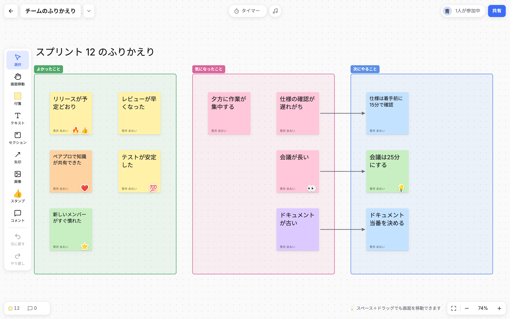
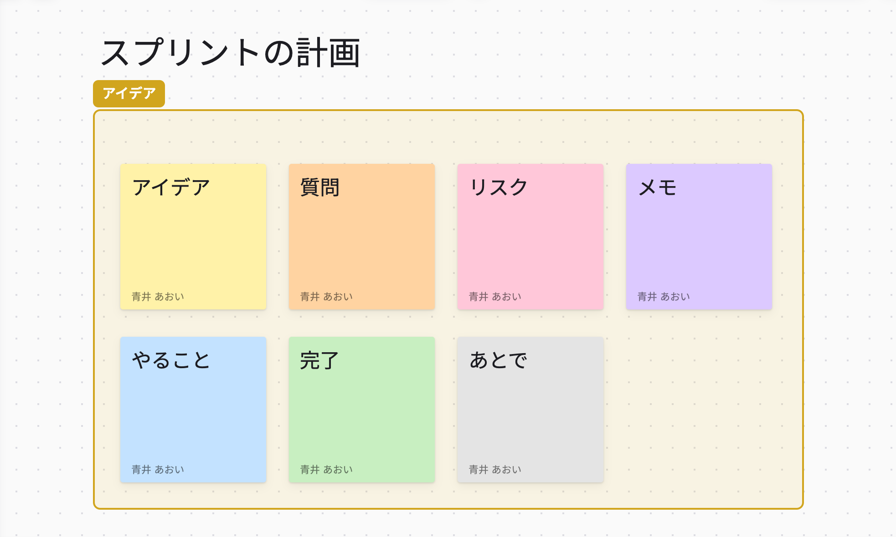
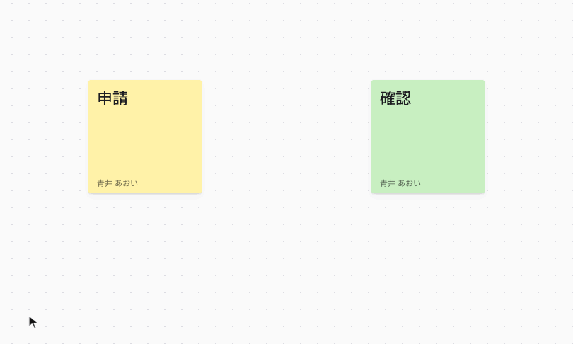
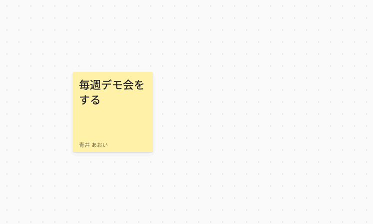
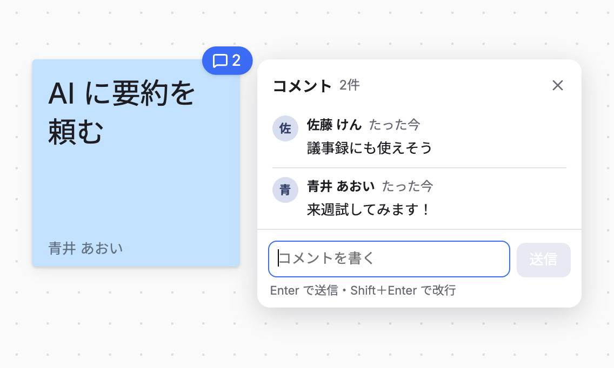
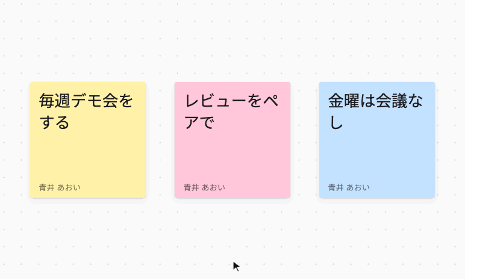
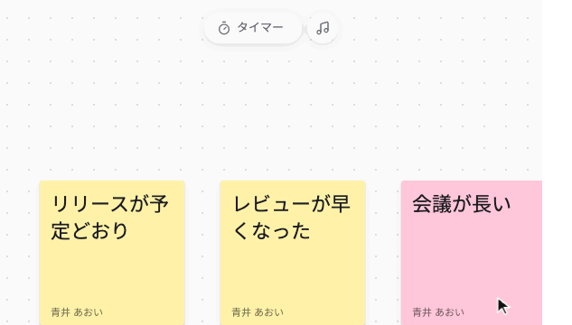
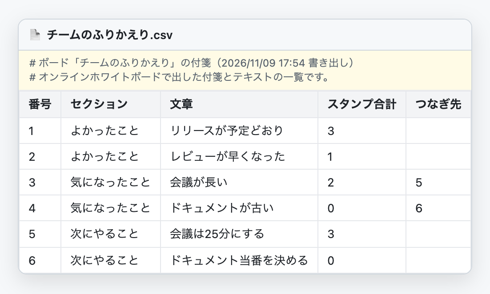
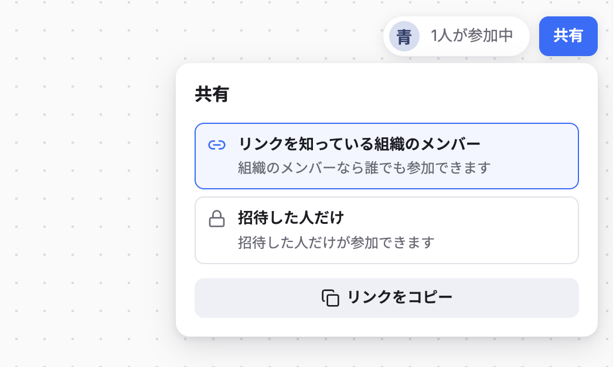

<div align="center">
  <picture>
    <source media="(prefers-color-scheme: dark)" srcset="docs/images/wordmark-dark.svg">
    
  </picture>
  <p><b>ブレスト・ふりかえり・業務フローの整理に使える、みんなで同時に書けるホワイトボード</b><br>
  付箋、動くスタンプ、矢印、全員で見るタイマーと BGM を、1つのボードで。</p>
  <p><a href="README.md">English</a> | <b>日本語</b></p>
</div>



## できること



**🗒 付箋とセクション**<br>
7色の付箋を貼り、セクションで囲んでまとめられます。お題や見出しには、背景のないテキストも使えます。図形（シェイプ）も追加予定です。

<br clear="all"><br>



**➡️ 矢印**<br>
付箋の ＋ をドラッグして、ほかの付箋につなげます。何もないところで離すと、つながった新しい付箋ができます。付箋を動かすと、矢印もついてきます。

<br clear="all"><br>



**👥 リアルタイムの同時編集**<br>
ほかの人が書いている内容が、そのまま自分の画面に出てきます。何人が同時に書いても大丈夫です。誰が参加中かも表示されます。

<br clear="all"><br>



**💬 コメント**<br>
ボードを散らかさずに、付箋ごとに話し合えます。コメントがある付箋には件数が出ます。

<br clear="all"><br>



**🎉 動くスタンプ**<br>
Google の Noto Emoji の動く絵文字9種類と、自分のプロフィール写真のスタンプ。貼ったときに2秒ほどぴょこっと動きます。投票にも使えます。

<br clear="all"><br>



**⏱ タイマーと BGM**<br>
全員の画面で同じように動くタイマーです。残り3秒で大きなカウントダウンが出て、終わると紙吹雪で知らせます。考える時間には、4曲から選んで BGM も流せます。

<br clear="all"><br>



**⬇️ CSV・HTML・PNG で書き出し**<br>
ブレストは、終わってからが本番。ボードを CSV・HTML・PNG で書き出せば、AI での分析や要約、チームへの共有、記録としての管理まで、そのまま次の作業につなげられます。

<br clear="all"><br>



**🔒 組織限定のログインと共有**<br>
ログインできるのは、許可したドメインの Google アカウントだけです。画面で隠すだけでなく、Firestore・Storage のセキュリティルールでデータの読み書きそのものを制限しています。ボードごとに、リンクを知っている組織のメンバー全員に見せるか、招待した人だけにするかも選べます。

<br clear="all">

## 使っている技術

- 画面：Vite + React + TypeScript（状態管理は Zustand）
- 基盤：Firebase（Hosting / Authentication / Firestore / Cloud Storage）
- ログイン：Google アカウント。ログインできるメールアドレスのドメインを指定できます（制限は Firestore・Storage のセキュリティルールで行っています）
- 画面の言語：日本語と英語（ブラウザの言語に合わせて切り替わり、アプリの中でも変えられます）

設計の詳細は [docs/design.md](docs/design.md)、操作の説明は [public/guide.html](public/guide.html) をご覧ください。

## 必要なもの

- Node.js 20 以上
- JDK 21（Firestore エミュレーター用）
  - macOS: `brew install openjdk@21`（PATH の設定は不要です。`scripts/firebase.mjs` がプロジェクトの中でだけ使います）
  - 別の場所に入れた場合は、`JAVA_HOME` を設定してください

firebase-tools はプロジェクトの devDependency に含まれているので、別にインストールする必要はありません。

## ローカルで動かす

Firebase Local Emulator Suite（手元で動く Firebase）を使うので、Firebase のプロジェクトがなくても試せます。

```bash
npm install
npm run dev
```

- アプリ：http://localhost:5173
- エミュレーターの管理画面：http://127.0.0.1:4000（Firestore のデータやログインしたユーザーを確認できます）

`npm run dev` を実行すると、Auth・Firestore・Storage のエミュレーターと Vite の開発サーバーが同時に起動します。プロジェクトは `demo-nboard`（エミュレーター専用のデモプロジェクト）なので、本物の Firebase には接続しません。エミュレーターのデータは終了時に `.emulator-data/` に保存され、次に起動したときに読み込まれます。

### ログイン（エミュレーター）

「Google でログイン」を押すと、エミュレーターのダミーのログイン画面が開きます。「Add new account」から、許可したドメインのメールアドレス（初期設定では `@example.com`）で架空のアカウントを作ってログインしてください。

複数人での同時編集を試すときは、別のブラウザ（またはシークレットウィンドウ）で別のアカウントにログインします。開発者ツールのコンソールから、次のようにログインすることもできます（エミュレーターを使っているときだけ有効です）。

```js
await __nboardSignIn('bob@example.com', '佐藤 ボブ')
```

## セキュリティルールのテスト

```bash
npm run test:rules
```

[tests/rules.test.ts](tests/rules.test.ts) を Firestore エミュレーター上で実行します。`npm run dev` の実行中なら起動しているエミュレーターを使い、そうでなければ一時的に起動します。テスト用の別のプロジェクト ID を使うので、開発中のデータには影響しません。ドメインの制限、ボードの一覧を取得できないこと、作成者だけがボードを削除できること、項目ごとの値の検証などを確認しています。

## ログインできるドメインを設定する

`.env.development`（ローカル）と `.env.production`（本番）の `VITE_ALLOWED_DOMAINS` に、ログインを許可するメールアドレスのドメインを書きます。カンマ区切りで複数指定できます。

```
VITE_ALLOWED_DOMAINS=your-company.co.jp
```

Firestore・Storage のセキュリティルールは環境変数を読めないため、[firestore.rules.template](firestore.rules.template) と [storage.rules.template](storage.rules.template) にこの値を埋め込んで、`firestore.rules` / `storage.rules` を生成しています（`npm run rules:build`）。エミュレーターの起動前とデプロイ前に自動で生成されるので、生成されたファイルは直接編集しないでください。

## アプリの名前・説明・アイコンを変える

画面に出す名前と説明は [.env](.env) で決めています。環境ごとに変えたいときは、`.env.production`（ローカルなら `.env.development`）に書いて上書きしてください。ヘッダー、ログイン画面、「このサービスについて」、ブラウザのタブに反映されます。

```
VITE_APP_NAME=N-Board
VITE_APP_TAGLINE_JA=みんなのホワイトボード
VITE_APP_TAGLINE_EN=Whiteboard for everyone
```

「このサービスについて」に出す、ご意見・ご要望の連絡先は `VITE_APP_CONTACT` で設定できます（空にすると表示しません）。画面の言葉は日本語と英語に対応していて、ブラウザの言語に合わせて切り替わります（アカウントのメニューとログイン画面から、手動で選ぶこともできます）。

アイコンを変えるときは、[public/favicon.svg](public/favicon.svg) を差し替えてください。使い方のページ（[public/guide.html](public/guide.html)）は設定を読まない静的なページなので、名前を変えたときは、こちらの「N-Board」も書き換えてください。

「このサービスについて」のいちばん下には、このリポジトリへのリンクつきで「Powered by N-Board」と表示されます。残してもらえるとうれしいですが、必須ではありません。消すときは `VITE_SHOW_POWERED_BY=false` にしてください。

## 自分の Firebase プロジェクトにデプロイする

コードを変える必要はありません。設定を差し替えるだけで切り替わります。

1. Firebase コンソールでプロジェクトを作り、次の設定をします
   - Authentication：ログイン方法で Google を有効にする
   - Firestore：データベースを作成する
   - Storage：バケットを作成する（貼った画像の保存に使います）
2. `.env.production.example` を `.env.production` にコピーし、Firebase コンソールの SDK 設定の値と、許可するドメインを書きます
3. `.firebaserc` の `production` を、自分のプロジェクト ID に変えます
4. [storage.cors.json](storage.cors.json) の `your-project-id` を自分のプロジェクト ID に変えて、バケットに設定します（`gcloud storage buckets update gs://<バケット名> --cors-file=storage.cors.json`）
5. デプロイします

   ```bash
   npx firebase login
   npm run deploy
   ```

   `npm run deploy` は、本番用のルールを生成し、画面をビルドして、Hosting と Firestore・Storage のルール・インデックスをデプロイします。デプロイのあとは、`npm run rules:build` で手元用のルールに戻してください。

## よく使うコマンド

| コマンド | 内容 |
|---|---|
| `npm run dev` | エミュレーターと開発サーバーを起動 |
| `npm run emulators` | エミュレーターだけを起動 |
| `npm run test:rules` | セキュリティルールのテスト |
| `npx vitest run` | ユニットテスト |
| `npm run typecheck` | 型チェック |
| `npm run build` | 本番用にビルド（`.env.production` を使用） |
| `npm run deploy` | 本番にデプロイ |

## 調整できる値

[src/constants.ts](src/constants.ts) にまとめています。

- `DRAG_WRITE_INTERVAL_MS`：ドラッグ中に位置を書き込む間隔です（初期値は 250ms）。小さくすると、ほかの人の画面での動きが滑らかになりますが、書き込みの回数が増えます
- `TEXT_WRITE_DEBOUNCE_MS`：文字を入力している途中で保存するまでの待ち時間です
- `PRESENCE_HEARTBEAT_MS` / `PRESENCE_TIMEOUT_MS`：参加中の表示を更新する間隔と、退出したとみなすまでの時間です

## バージョンとオープンソースのライセンス

- 「このサービスについて」に、`package.json` の `version` と、ビルドした日を表示します（開発サーバーでは「開発版」と表示します）
- 同じ画面に、アプリが直接使っているパッケージとそのライセンスを一覧で表示します
- 依存しているパッケージの依存先まで含めたライセンスの全文は、`scripts/build-licenses.mjs` が `public/licenses.txt` に書き出します（開発サーバーの起動前とビルド前に自動で実行されます。生成されたファイルなので、コミットはしません）

## クレジット

- 効果音・BGM：[OtoLogic](https://otologic.jp/)（[CC BY 4.0](https://creativecommons.org/licenses/by/4.0/deed.ja)）。BGM はループ再生用に編集しています。詳しくは [public/sounds/CREDITS.md](public/sounds/CREDITS.md) と [public/music/CREDITS.md](public/music/CREDITS.md) をご覧ください
- スタンプ：[Noto Emoji](https://github.com/googlefonts/noto-emoji)（Apache License 2.0）と [Noto Emoji Animation](https://googlefonts.github.io/noto-emoji-animation/)（CC BY 4.0）。詳しくは [public/stamps/CREDITS.md](public/stamps/CREDITS.md) をご覧ください
- アプリの中では、アカウントのメニュー →「このサービスについて」にクレジットを表示しています

## これから追加する予定の機能

- **シェイプ**：四角、丸、ひし形などの図形。付箋と組み合わせて、フローチャートや図を描けるようにします

などなど

## このプロジェクトについて

N-Board は、エンジニアではない作者が AI（Claude）と一緒に楽しく作ったツールです。

セキュリティルールのテストや、AI によるセキュリティのチェックなど、気をつけて作っていますが、エンジニアによるコードのレビューは受けていません。[MIT ライセンス](LICENSE)のとおり、N-Board は無保証で提供しています。組織で使うときは、セキュリティルール（[firestore.rules.template](firestore.rules.template) と [storage.rules.template](storage.rules.template)）や設定を、ご自身でも確認してください。不具合や気づいたことがあれば、[Issues](https://github.com/ngtmskz/n-board/issues) で教えてもらえるとうれしいです。

## 使ったら、ぜひ教えてください

職場でも、授業でも、ちょっと遊んでみただけでも、N-Board を使ってもらえたら、ぜひ教えてください！[Issues](https://github.com/ngtmskz/n-board/issues) にひとこと書いてもらったり、⭐ を押してもらえたりすると、作者が小躍りして喜びます 🙌

## 作者

Masa Nagata（[@ngtmskz](https://github.com/ngtmskz)）

## ライセンス

[MIT](LICENSE)（上記の素材は、それぞれのライセンスに従います）
