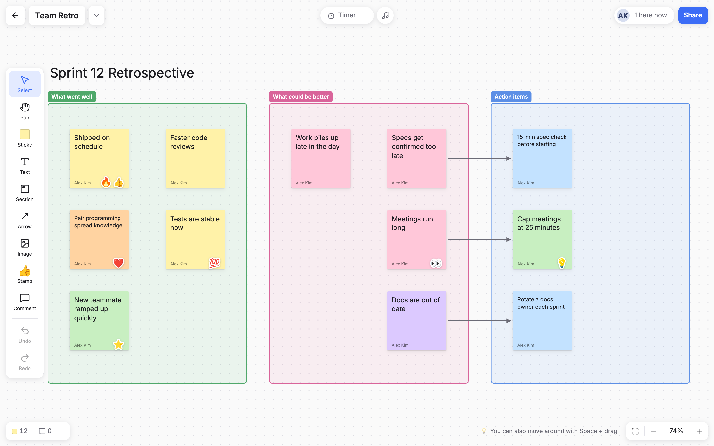
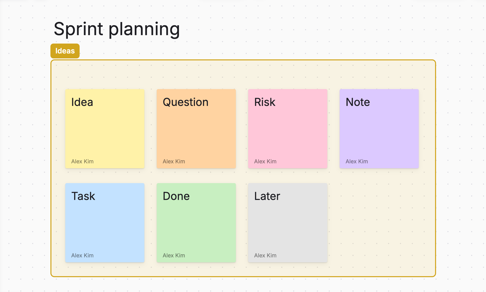
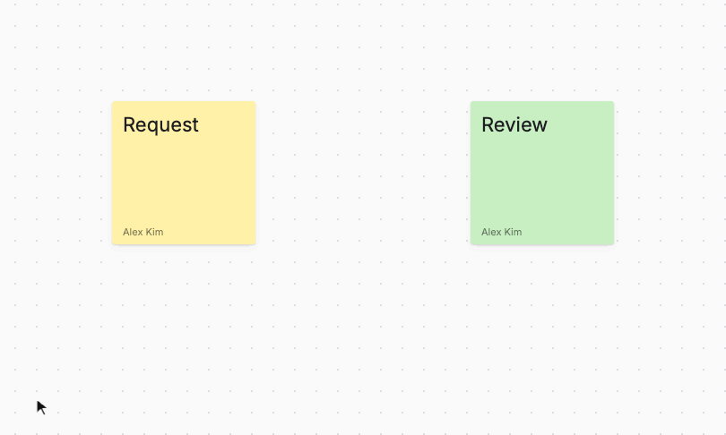
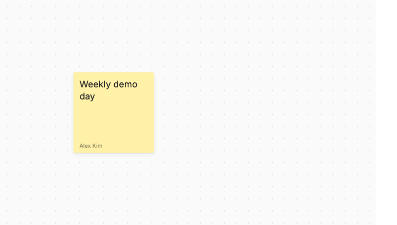
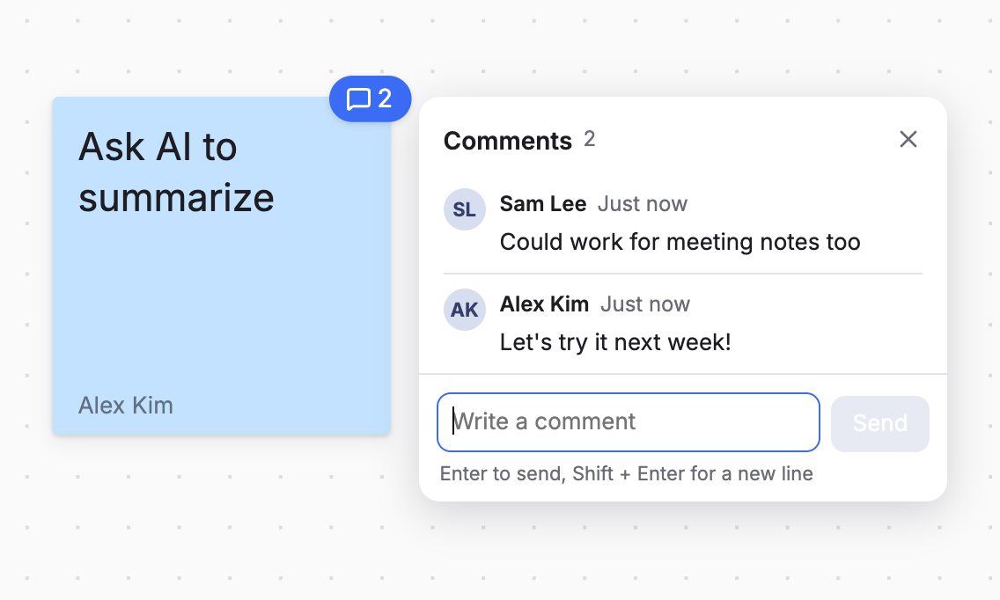
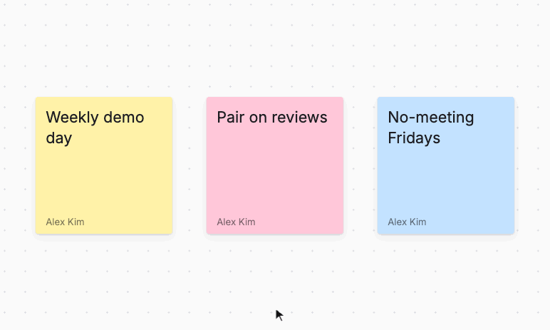
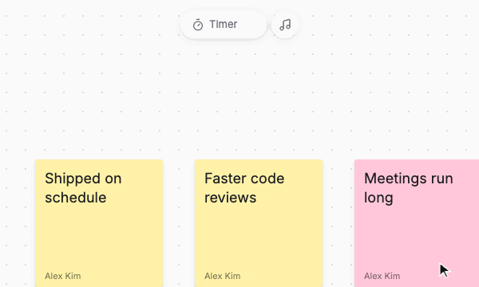
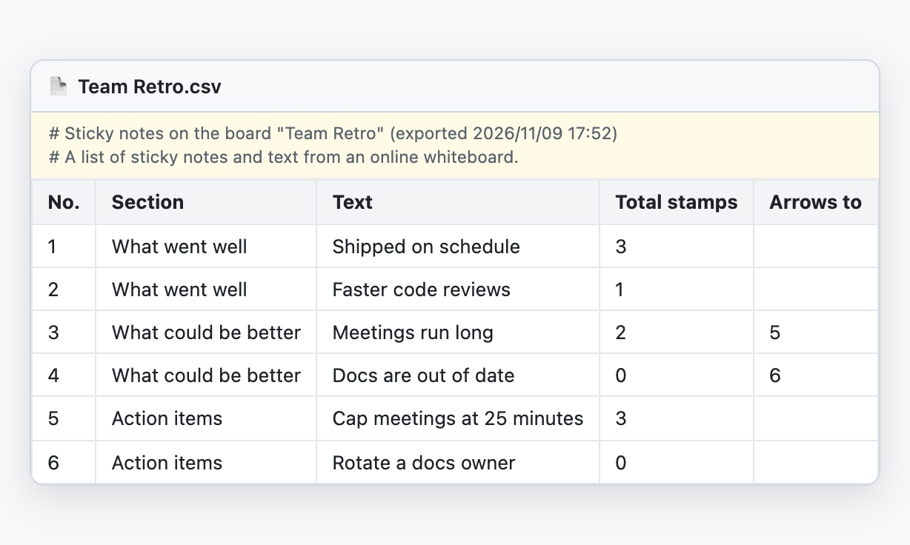
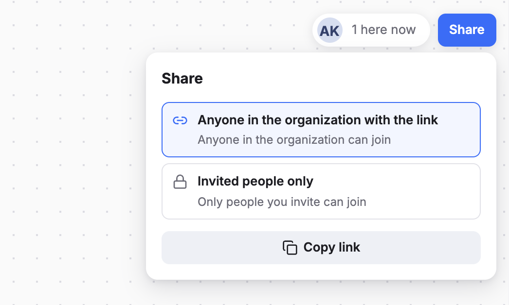

<div align="center">
  <picture>
    <source media="(prefers-color-scheme: dark)" srcset="docs/images/wordmark-dark.svg">
    
  </picture>
  <p><b>A realtime collaborative whiteboard for brainstorming, retros and workflow mapping.</b><br>
  Sticky notes, animated stamps, arrows, a shared timer and music — on one board everyone edits together.</p>
  <p><b>English</b> | <a href="README.ja.md">日本語</a></p>
</div>



## Features



**🗒 Sticky notes and sections**<br>
Sticky notes in 7 colors. Group them into sections, and add plain text for titles and headings. Shapes are coming soon.

<br clear="all"><br>



**➡️ Arrows**<br>
Drag the ＋ on a sticky note to connect it to another one. Let go in empty space and a new, connected note appears. Arrows follow when you move things.

<br clear="all"><br>



**👥 Realtime collaboration**<br>
What others write shows up on your screen as they type — even when several people are writing at once. You can also see who's on the board.

<br clear="all"><br>



**💬 Comments**<br>
Discuss a sticky note without cluttering the board. Notes with comments show a count badge.

<br clear="all"><br>



**🎉 Animated stamps**<br>
9 stamps based on Google's Noto Emoji animations, plus one with your profile photo. They bounce for about 2 seconds when they land — and double as votes.

<br clear="all"><br>



**⏱ Timer and music**<br>
One timer for everyone on the board, with a big countdown for the last 3 seconds and confetti at zero. Pick from 4 looping background tracks while you think.

<br clear="all"><br>



**⬇️ Export to CSV, HTML or PNG**<br>
The brainstorm doesn't end when the meeting does. Export the board to CSV, HTML or PNG and carry it straight into what comes next — analyzing and summarizing ideas with AI, sharing results with your team, and keeping a record.

<br clear="all"><br>



**🔒 Organization-only sign-in and sharing**<br>
Only Google accounts in the domains you allow can sign in. Access isn't just hidden in the UI — Firestore and Storage security rules block reading and writing the data itself. For each board, you can choose whether everyone in your organization with the link can join, or only the people you invite.

<br clear="all">

## Tech stack

- Frontend: Vite + React + TypeScript (state management with Zustand)
- Backend: Firebase (Hosting / Authentication / Firestore / Cloud Storage)
- Sign-in: Google accounts, limited to the email domains you allow (enforced by Firestore and Storage security rules)
- UI languages: English and Japanese (follows the browser language, and can be switched in the app)

See [docs/design.md](docs/design.md) for design notes (Japanese) and [public/guide.html](public/guide.html) for the user guide (Japanese).

## Requirements

- Node.js 20 or later
- JDK 21 (for the Firestore emulator)
  - macOS: `brew install openjdk@21` (no PATH setup needed; `scripts/firebase.mjs` uses it only inside this project)
  - If you installed it elsewhere, set `JAVA_HOME`

firebase-tools is included as a devDependency, so you don't need to install it separately.

## Run locally

Everything runs on the Firebase Local Emulator Suite, so you don't need a Firebase project to try it.

```bash
npm install
npm run dev
```

- App: http://localhost:5173
- Emulator UI: http://127.0.0.1:4000 (browse Firestore data and signed-in users)

`npm run dev` starts the Auth, Firestore and Storage emulators together with the Vite dev server. It uses the `demo-nboard` project, which exists only in the emulator, so nothing connects to a real Firebase project. Emulator data is saved to `.emulator-data/` on exit and loaded on the next start.

### Signing in (emulator)

Click "Sign in with Google" to open the emulator's fake sign-in page. Choose "Add new account" and create a made-up account with an email in an allowed domain (`@example.com` by default).

To try realtime editing with several people, sign in with another account in a different browser or a private window. You can also sign in from the developer console (emulator only):

```js
await __nboardSignIn('bob@example.com', 'Bob')
```

## Security rules tests

```bash
npm run test:rules
```

Runs [tests/rules.test.ts](tests/rules.test.ts) against the Firestore emulator. If `npm run dev` is running, it uses that emulator; otherwise it starts one temporarily. Tests use a separate project ID, so your development data is not affected. They cover the domain restriction, blocking board listing, letting only the creator delete a board, field validation and more.

## Allowed sign-in domains

Set `VITE_ALLOWED_DOMAINS` in `.env.development` (local) and `.env.production` (production) to the email domains that may sign in. Separate multiple domains with commas.

```
VITE_ALLOWED_DOMAINS=your-company.com
```

Security rules can't read environment variables, so this value is embedded into [firestore.rules.template](firestore.rules.template) and [storage.rules.template](storage.rules.template) to generate `firestore.rules` / `storage.rules` (`npm run rules:build`). They are generated automatically before the emulator starts and before deploying, so don't edit the generated files directly.

## App name, tagline and icon

The name and tagline shown in the app are set in [.env](.env). To change them per environment, override them in `.env.production` (or `.env.development` locally). They appear in the header, the sign-in page, the "About this service" dialog and the browser tab.

```
VITE_APP_NAME=N-Board
VITE_APP_TAGLINE_JA=みんなのホワイトボード
VITE_APP_TAGLINE_EN=Whiteboard for everyone
```

`VITE_APP_CONTACT` sets the feedback contact shown in the "About this service" dialog (hidden when empty). The UI language follows the browser and can also be switched from the account menu or the sign-in page.

To change the icon, replace [public/favicon.svg](public/favicon.svg). The user guide ([public/guide.html](public/guide.html)) is a static page, so if you rename the app, update the name there too.

The bottom of the "About this service" dialog shows "Powered by N-Board" with a link to this repository. You're welcome to keep it, but it isn't required — set `VITE_SHOW_POWERED_BY=false` to hide it.

## Deploy to your own Firebase project

No code changes are needed — only configuration.

1. Create a project in the Firebase console and set up:
   - Authentication: enable the Google sign-in provider
   - Firestore: create a database
   - Storage: create a bucket (used for pasted images)
2. Copy `.env.production.example` to `.env.production` and fill in the SDK config values from the Firebase console and your allowed domains
3. Set `production` in `.firebaserc` to your project ID
4. Replace `your-project-id` in [storage.cors.json](storage.cors.json) with your project ID and apply it to the bucket (`gcloud storage buckets update gs://<bucket-name> --cors-file=storage.cors.json`)
5. Deploy

   ```bash
   npx firebase login
   npm run deploy
   ```

   `npm run deploy` generates the production rules, builds the app, and deploys Hosting plus the Firestore and Storage rules and indexes. Afterwards, run `npm run rules:build` to switch the local rules back to development.

## Commands

| Command | Description |
|---|---|
| `npm run dev` | Start the emulators and the dev server |
| `npm run emulators` | Start only the emulators |
| `npm run test:rules` | Security rules tests |
| `npx vitest run` | Unit tests |
| `npm run typecheck` | Type check |
| `npm run build` | Production build (uses `.env.production`) |
| `npm run deploy` | Deploy to production |

## Tuning

Values are collected in [src/constants.ts](src/constants.ts).

- `DRAG_WRITE_INTERVAL_MS`: how often positions are written while dragging (default 250 ms). Smaller values make movement smoother on other people's screens but increase writes
- `TEXT_WRITE_DEBOUNCE_MS`: delay before saving while typing
- `PRESENCE_HEARTBEAT_MS` / `PRESENCE_TIMEOUT_MS`: how often presence is updated, and how long until someone is treated as having left

## Version and open source licenses

- The "About" dialog shows the `version` from `package.json` and the build date ("development build" on the dev server)
- It also lists the packages the app uses directly and their licenses
- `scripts/build-licenses.mjs` writes the full license texts, including transitive dependencies, to `public/licenses.txt` (runs automatically before the dev server and builds; it's generated, so it isn't committed)

## Credits

- Sound effects and music: [OtoLogic](https://otologic.jp/) ([CC BY 4.0](https://creativecommons.org/licenses/by/4.0/)). The music was edited into seamless loops. See [public/sounds/CREDITS.md](public/sounds/CREDITS.md) and [public/music/CREDITS.md](public/music/CREDITS.md)
- Stamps: [Noto Emoji](https://github.com/googlefonts/noto-emoji) (Apache License 2.0) and [Noto Emoji Animation](https://googlefonts.github.io/noto-emoji-animation/) (CC BY 4.0). See [public/stamps/CREDITS.md](public/stamps/CREDITS.md)
- Credits are also shown in the app under the account menu → "About this service"

## Roadmap

- **Shapes** — Rectangles, circles, diamonds and more, for drawing flowcharts and diagrams alongside sticky notes

…and more

## About this project

N-Board is a tool that a non-engineer had a lot of fun building together with AI (Claude).

I've built it with care, including tests for the security rules and an AI-assisted security review, but the code hasn't been reviewed by an engineer. As the [MIT License](LICENSE) says, N-Board is provided "as is", without warranty of any kind. If you use it in your organization, please review the security rules ([firestore.rules.template](firestore.rules.template) and [storage.rules.template](storage.rules.template)) and your settings yourself. Bug reports and suggestions in [Issues](https://github.com/ngtmskz/n-board/issues) are always welcome.

## I'd love to hear from you

If you try N-Board — at work, in class, or just for fun — please let me know! A quick note in [Issues](https://github.com/ngtmskz/n-board/issues) or a ⭐ will absolutely make my day 🙌

## Author

Masa Nagata ([@ngtmskz](https://github.com/ngtmskz))

## License

[MIT](LICENSE) (the assets above are under their own licenses)
